# Phân tích màu sắc HSV và CIELAB kết hợp học máy để phân loại độ chín và phát hiện khuyết tật trên quả xoài

**Báo cáo tổng kết khoa học Phase 8 — MangoResearch**  
Phiên bản: 1.0 · Ngày tổng hợp: 25-10-2026  
Phạm vi dữ liệu: artifact Phase 0–7 hiện có; không huấn luyện lại mô hình.

## Tóm tắt

Nghiên cứu xây dựng một quy trình xử lý ảnh màu nhằm mô tả độ chín và hỗ trợ phân loại tình trạng khuyết tật ở xoài. Hệ thống gồm chuẩn hóa màu Gray World, phân tích HSV/CIELAB, tách vùng quả bằng ngưỡng và hình thái học, phân vùng màu nghi vấn bằng K-Means, trích xuất đặc trưng thống kê, các bộ phân loại KNN/SVM-RBF/Random Forest và giao diện suy luận Streamlit. Ba nguồn dữ liệu chính được giữ tách theo mục đích: Dataset A cho độ chín, Dataset B làm nguồn ảnh lỗi để chú giải, Dataset C cho phân loại healthy/defective và pseudo-label phân vùng. Dataset v2 chỉ được dùng để khảo sát external/domain shift.

Kết quả đáng chú ý cần được hiểu theo đúng cấp độ bằng chứng. Trên 34 ảnh có mask toàn quả được người dùng duyệt, cấu hình Original + Lab b* + Otsu đạt IoU trung bình 0,8412 và Dice 0,8993; Gray World trên cùng các ảnh đạt 0,7965 và 0,8684. Trên 30 ảnh có mask tổn thương được người dùng xác nhận, hai cấu hình K-Means được so sánh paired: Original + Lab K=3 đạt IoU/Dice trung bình theo ảnh 0,3931/0,5141, còn Original + HSV K=5 đạt 0,3048/0,4346. HSV có recall pixel gộp và detection hit cao hơn, nhưng cũng tạo nhiều false-positive pixel hơn. Các mask tham chiếu này được Codex khởi tạo bán tự động và người dùng duyệt; chúng không phải chú giải pixel độc lập hoàn toàn.

Ở phân loại, model Phase 5.1 được giữ nguyên là Gray World + KNN cho độ chín và Original Color + SVM-RBF cho healthy/defective. Trên test split provisional lần lượt n=112 và n=540, Accuracy/Macro-F1 là 0,9018/0,9021 và 0,9630/0,9626. Cả hai vẫn có `official_accuracy_eligible=false` do rủi ro lineage/near-duplicate chưa được giải quyết đầy đủ. External MangoFruitBD có coverage dự đoán 12,6% trên 1.811 crop đủ điều kiện; trên 228 crop có dự đoán, Accuracy 0,6667 và Macro-F1 0,5061 theo ánh xạ nhãn proxy. Kết quả external không tương đương test nội bộ. Tập dữ liệu được chọn có chủ đích, nhỏ và không đại diện benchmark tổng quát; báo cáo không khẳng định hệ thống đã sẵn sàng cho ứng dụng thương mại hoặc chẩn đoán bệnh.

**Từ khóa:** xoài; HSV; CIELAB; Gray World; Otsu; K-Means; KNN; SVM-RBF; Random Forest; domain shift; segmentation.

## Chương 1 — Mở đầu

### 1.1 Bối cảnh

Đánh giá chất lượng nông sản thường cần quan sát đồng thời màu sắc, hình dạng và dấu hiệu bề mặt. Ảnh số tạo điều kiện lượng hóa một phần các dấu hiệu này theo quy trình lặp lại, nhưng màu ghi nhận trong ảnh phụ thuộc ánh sáng, thiết bị, cân bằng trắng, nền và góc nhìn. Do đó, một hệ thống dùng màu cần tách rõ ba việc: chuẩn hóa/biểu diễn màu, xác định vùng quả, và suy luận từ dữ liệu có nhãn. Một vùng tối do bóng đổ hoặc nền không thể mặc định là tổn thương; màu vỏ tự nhiên cũng không phải nhãn bệnh.

Xoài phù hợp với nghiên cứu này vì ảnh có biến thiên màu rõ trong quá trình chín, đồng thời có thể quan sát đốm, sẹo, vết rách và vùng hư hỏng trên vỏ. Dataset A cung cấp ba nhãn độ chín, trong khi Dataset B và C cung cấp các dạng dữ liệu khuyết tật khác nhau [1]–[3]. Những nhãn này không đồng nghĩa: `ripe` là giai đoạn chín; `healthy/defective` là nhãn cấp quả; còn mask tổn thương là nhãn pixel. Không gộp chúng thành một khái niệm duy nhất.

### 1.2 Vấn đề và mục tiêu

Đề tài khảo sát liệu thống kê màu HSV/CIELAB, có và không có Gray World, kết hợp các bộ phân loại truyền thống có thể phân loại nhãn độ chín và healthy/defective trong các cohort hiện có hay không. Phần phân vùng K-Means được nghiên cứu như một bản đồ màu nghi vấn, không phải bộ phân loại bệnh. Tách quả là bước tiền xử lý cần thiết để giảm ảnh hưởng nền nhưng hiện vẫn là heuristic.

Mục tiêu Phase 8 là tổng hợp bằng chứng Phase 0–7 thành một báo cáo truy xuất được. Không huấn luyện lại model, không thay split, không thay dữ liệu và không hiệu chỉnh K-Means. Các số liệu được báo theo đúng artifact, tập ảnh, split và trạng thái nhãn đã tạo ra chúng.

### 1.3 Phạm vi, đóng góp và giới hạn

Các đóng góp thực tế gồm: (i) pipeline màu có provenance từ ảnh gốc đến feature/model; (ii) so sánh classifier với group-aware CV và validation; (iii) tách biệt pseudo-label Dataset C, mask toàn quả do người dùng duyệt và mask tổn thương Codex-assisted do người dùng duyệt; (iv) ghi nhận coverage, lỗi suy luận và domain shift thay vì chỉ báo metric có điều kiện. Giới hạn chính là nguồn dữ liệu không đồng nhất, near-duplicate/augmentation lineage còn rủi ro, tách quả heuristic, tập mask nhỏ và có chủ đích, cùng nhãn external không hoàn toàn tương thích. Vì vậy kết quả là thực nghiệm thăm dò có truy nguyên, chưa phải xác nhận hiệu năng triển khai.

## Chương 2 — Cơ sở lý thuyết

### 2.1 RGB, HSV và CIELAB

RGB biểu diễn mỗi pixel bằng ba kênh đỏ, lục, lam. Đây là không gian thiết bị thuận tiện để lưu và hiển thị ảnh, nhưng khoảng cách Euclid giữa hai bộ RGB không đồng nhất với cảm nhận chênh lệch màu. HSV tách sắc độ (Hue), độ bão hòa (Saturation) và độ sáng (Value). Với R,G,B đã chuẩn hóa về [0,1], đặt \(M=\max(R,G,B)\), \(m=\min(R,G,B)\), \(\Delta=M-m\):

\[
V=M,\qquad S=\begin{cases}\Delta/M,&M>0\\0,&M=0.\end{cases}
\]

Khi \(\Delta=0\), hue không xác định (thường được mã hóa 0). Nếu kênh cực đại lần lượt là R,G,B thì:

\[
H=60\begin{cases}(G-B)/\Delta\pmod 6,&M=R\\(B-R)/\Delta+2,&M=G\\(R-G)/\Delta+4,&M=B.\end{cases}
\]

Trong pipeline float HSV, H nằm trên vòng [0°,360°), còn S,V thuộc [0,1]; hue là đại lượng tuần hoàn nên trung bình số học gần 0°/360° có thể sai, cần thống kê vòng tròn. Cách mã hóa OpenCV khác theo kiểu dữ liệu: ảnh 8-bit có thang hue rút gọn, còn ảnh float giữ hue theo độ [8]. Vì vậy phải ghi rõ dải giá trị và kiểu dữ liệu khi tái lập.

CIELAB (L*,a*,b*) được chuẩn hóa từ XYZ so với điểm trắng tham chiếu; L* mô tả độ sáng, a* trục xanh lục–đỏ, b* trục xanh lam–vàng. Dạng chuẩn dùng hàm:

\[
f(t)=\begin{cases}t^{1/3},&t>(6/29)^3\\t/[3(6/29)^2]+4/29,&\text{ngược lại},\end{cases}
\]
\[
L^*=116f(Y/Y_n)-16,\quad a^*=500[f(X/X_n)-f(Y/Y_n)],\quad b^*=200[f(Y/Y_n)-f(Z/Z_n)].
\]

CIELAB được thiết kế để biểu diễn màu vật thể với tính gần đồng đều cảm nhận hơn XYZ trong những điều kiện quy định [7]. Trong nghiên cứu, Lab b* hữu ích cho phân biệt thành phần xanh–vàng của vỏ trong heuristic tách quả; điều đó không biến một giá trị b* thành tiêu chuẩn sinh học.

Đặc trưng thống kê được trích trên vùng ảnh hợp lệ gồm trung bình, độ phân tán, phân vị, histogram, tỉ lệ màu theo ngưỡng và chỉ số vùng K-Means. Hue được tóm tắt theo vòng tròn. Background, mask heuristic không hợp lệ và feature block thiếu được giữ phân biệt; missing value không được đổi thành 0 vì 0 có thể là một giá trị quan sát có nghĩa.

### 2.2 Gray World

Gray World giả định trung bình màu của toàn cảnh gần trung tính. Với trung bình từng kênh \(\mu_R,\mu_G,\mu_B\), đặt \(\mu=(\mu_R+\mu_G+\mu_B)/3\) và gain \(g_c=\mu/\mu_c\); sau đó \(I'_c(x,y)=\operatorname{clip}(g_cI_c(x,y))\). Đây là mô hình cân bằng màu đơn giản, không phải phép đo illuminant hay bảo đảm khôi phục màu thật [6]. Nếu nền hoặc quả chiếm phần lớn ảnh với màu thiên lệch, phép cân bằng có thể dịch chuyển tín hiệu thật và gây clipping.

### 2.3 Ngưỡng, Otsu, morphology và thành phần liên thông

Ngưỡng cố định phân lớp pixel theo kênh: \(M(x,y)=1[I_c(x,y)>T]\), hoặc đảo chiều với bất đẳng thức ngược. Ngưỡng Otsu chọn ngưỡng \(t\) tối đa hóa phương sai giữa hai lớp histogram:

\[
\sigma_B^2(t)=w_0(t)w_1(t)[\mu_0(t)-\mu_1(t)]^2.
\]

Otsu là ngưỡng tự động theo histogram, không dùng nhãn ngữ nghĩa và không đảm bảo phân đoạn đúng quả [9]. Erosion và dilation lấy cực tiểu/cực đại trong lân cận kernel; opening là erosion rồi dilation, closing là dilation rồi erosion. Chúng loại nhiễu nhỏ hoặc nối khe theo hình thái nhưng có thể xóa chi tiết nhỏ [15]. Connected components gán nhãn các vùng pixel kề nhau để đo diện tích, độ liên tục hoặc chọn thành phần lớn [15]. Trong pipeline, threshold/morphology/component ranking tạo mask heuristic chứ không tạo ground truth.

### 2.4 K-Means phân vùng màu

Cho vector màu/đặc trưng pixel \(z_i\), K-Means tối thiểu hóa:

\[
J=\sum_i\min_{k\in\{1,\ldots,K\}}\|z_i-\mu_k\|_2^2,
\]

luân phiên gán pixel vào tâm gần nhất và cập nhật tâm bằng trung bình các phần tử trong cụm [10]. Trong nghiên cứu, K-Means chạy trên pixel vùng quả heuristic; một quy tắc đã khóa chọn cụm màu nghi vấn. K=3 trong Lab và K=5 trong HSV là cấu hình Phase 3 cố định. K-Means chỉ nhóm màu, không nhận biết bệnh; bóng, sắc tố tự nhiên, vùng chín, sẹo và đốm có thể cùng tạo ra cụm màu tương tự.

### 2.5 Bộ phân loại

KNN gán lớp theo đa số (hoặc trọng số khoảng cách) của k điểm huấn luyện gần nhất. KNN nhạy với scale và mật độ mẫu; pipeline chuẩn hóa trước khi đo khoảng cách [11]. SVM tìm siêu phẳng có biên lớn; kernel RBF \(K(x,z)=\exp(-\gamma\|x-z\|^2)\) cho phép biên phi tuyến trong không gian đặc trưng [12]. Random Forest tổng hợp nhiều cây quyết định được tạo từ mẫu bootstrap và tập biến ngẫu nhiên; biểu quyết của rừng thường giảm phương sai so với một cây đơn [13]. Không thuật toán nào tự giải quyết sai nhãn, leakage hoặc lệch miền.

### 2.6 Metric và thiết kế đánh giá

Với confusion matrix \(C_{ij}\) (hàng là lớp thật, cột là lớp dự đoán):

\[
Accuracy=\frac{\sum_iC_{ii}}{N},\quad Precision=\frac{TP}{TP+FP},\quad Recall=\frac{TP}{TP+FN},\quad F1=\frac{2PR}{P+R}.
\]

Macro-F1 là trung bình không trọng số F1 theo lớp, để mỗi lớp có trọng số ngang nhau [16]. Với segmentation nhị phân:

\[
IoU=\frac{TP}{TP+FP+FN},\qquad Dice=\frac{2TP}{2TP+FP+FN}=\frac{2IoU}{1+IoU}.
\]

IoU/Dice trong bộ assisted được tính riêng từng ảnh rồi lấy mean; pixel precision/recall và FP/FN được gộp pixel trên toàn tập. Detection hit chỉ đánh dấu có ít nhất một pixel giao nhau (TP>0), không biểu diễn tỷ lệ diện tích được phát hiện. Coverage là số ảnh có suy luận / số ảnh đủ điều kiện; metric có điều kiện trên ảnh suy luận được phải luôn đi cùng coverage.

Nếu ảnh cùng quả, cùng phiên chụp hoặc cùng lineage augmentation xuất hiện ở cả train và test, mô hình có thể khai thác dấu hiệu nguồn chung thay vì học quy luật tổng quát. Group-aware split giữ group đã biết trong một split và cố gắng cân bằng lớp; StratifiedGroupKFold hỗ trợ đồng thời nhóm và phân tầng [14]. Cách này không khử các quan hệ nguồn chưa biết. Domain shift là khác biệt về thiết bị, nền, giống, điều kiện chiếu sáng hoặc định nghĩa nhãn giữa tập phát triển và tập sử dụng; external metric cần diễn giải kèm mapping nhãn và coverage.

## Chương 3 — Dữ liệu và phương pháp

### 3.1 Nguồn dữ liệu, định nghĩa và số lượng

| Tập | Vai trò trong nghiên cứu | Quy mô nguồn / cohort dùng | Nhãn và giới hạn |
|---|---|---:|---|
| Dataset A — Alphonso Ripening [1] | Huấn luyện/đánh giá độ chín | 750 ảnh nguồn; 748 ảnh hợp lệ sau khử exact duplicate | 249 unripe, 249 partially_ripe, 250 ripe trong manifest dùng được; không có nhãn defect/mask |
| Dataset B — MangoFruitDefect [2] | Nguồn ảnh tổn thương và bộ mask assisted được người dùng duyệt | 1.486 ảnh trong archive; 1.406 hợp lệ sau exact duplicate; 30 ảnh được chọn cho bộ assisted | Nhãn nguồn defective theo mô tả collection; không có healthy control hay mask nguồn; 30 ảnh chú giải không đại diện toàn tập |
| Dataset C — Uganda [3] | Phân loại healthy/defective và pseudo-label K-Means | Archive inventory 10.487; defect-analysis cohort 3.604 (1.993 defective, 1.611 healthy); 1.500 cặp ảnh/mask segmentation | Nguồn ghi 1.611 healthy, 957 raw damaged + 6.419 augmented, 1.500 ảnh segmentation + mask; lineage augmentation chưa giải quyết |
| Harumanis v2 [4] | External mô tả đầu ra độ chín | 141 candidate, 139 có dự đoán | Nhãn unripe/semi-ripe/ripe/rotten; chưa xác minh mapping semi_ripe và rotten với lớp đích |
| MangoFruitBD v2 [5] | External/domain-shift defect proxy | 1.914 crop candidate; 1.811 đủ điều kiện metric chính; 228 có dự đoán trên nhóm đủ điều kiện | Healthy/Alternaria/Anthracnose/Scab; ánh xạ nhị phân không tương đương nhãn defect C hoặc mask bruise |

*Bảng 1. Nguồn dữ liệu, phạm vi cohort và định nghĩa nhãn dùng trong nghiên cứu.*

Dataset A mô tả ba giai đoạn chín với 250 ảnh mỗi lớp [1]. Dataset B được mô tả là ảnh Alphonso có khuyết tật chụp trong môi trường có kiểm soát [2]. Dataset C là nguồn giống địa phương Uganda, ảnh smartphone/ánh sáng tự nhiên theo mô tả nhà cung cấp [3]. Những con số trên là hai phạm vi khác nhau: archive và cohort nội bộ đã qua kiểm tra/chọn task. Chúng không được cộng thành một tập huấn luyện duy nhất.

Phase 0 phát hiện exact duplicates theo file/pixel hashes. Dataset A có 2 bản trùng bị loại khỏi manifest phân tích; Dataset B có 80; Dataset C có 679 bản dư theo inventory. 1.500 mask segmentation Dataset C ban đầu có 512×512 trong khi ảnh là 224×224; Phase 0.2 đã căn chỉnh mask bằng nearest-neighbor và lưu normalized mask. Chỉ 24 cặp từng được xem trực quan ở bước đó; kích thước/nhị phân đúng không chứng minh từng mask đúng ngữ nghĩa. Augmentation lineage của C vẫn chưa đầy đủ.

### 3.2 Chia tập và kiểm soát leakage

Phase 0.2 split còn được giữ lại như artifact lịch sử. Phase 5.1 tạo split phân nhóm riêng, seed 20261023, gần 70/15/15 và dùng validation để chọn cấu hình; GridSearchCV 5-fold StratifiedGroupKFold chạy trên train, imputer/scaler nằm trong pipeline. Tập test được mở một lần sau khi khóa lựa chọn. Split này không thay đổi split Phase 0.2.

| Nhiệm vụ | N | Train | Validation | Test khóa | Nhóm đã biết | Near-duplicate cross-split chưa xác minh | Trạng thái |
|---|---:|---:|---:|---:|---:|---:|---|
| Độ chín A | 748 | 524 | 112 | 112 | 747 | 2.273 cặp; 518 ảnh bị ảnh hưởng | Provisional; `official_accuracy_eligible=false` |
| Defect C | 3.604 | 2.523 | 541 | 540 | 2.430 | 872 cặp; 563 ảnh bị ảnh hưởng | Provisional; `official_accuracy_eligible=false` |

*Bảng 2. Split Phase 5.1; candidate chưa xác minh không được xem là leakage đã được xác nhận, nhưng giữ eligibility provisional.*

Tất cả known groups được giữ trong một split, nhưng các candidate gần trùng chưa xác minh vẫn tồn tại. Với defect có một cặp cùng nguồn được xác nhận nhưng nhãn healthy/defective mâu thuẫn; cả hai giữ nguyên nhãn và ở cùng split. SSIM/dHash tạo candidate, không phải bằng chứng nhận dạng quả. Vì thế test Phase 5.1 không được trình bày là accuracy benchmark chính thức.

### 3.3 Tiền xử lý và biểu diễn màu

Ảnh được đọc thành RGB và tạo analysis raster bảo toàn tỷ lệ với cạnh dài tối đa 512 pixel. Gray World là nhánh tiền xử lý riêng. Các feature HSV/CIELAB và thống kê vùng được tính trên raster phân tích; với các bảng màu Phase 1, thống kê bao gồm cả nền vì chưa dùng fruit mask. Với feature Phase 4, mask quả Phase 2 là heuristic; khi mask hoặc K-Means không khả dụng, các feature tương ứng được để thiếu và trạng thái được lưu trong manifest.

Phase 1 dùng 14 ảnh chọn deterministic, hai nhánh Original (E1) và Gray World (E2), tổng cộng 28 dòng, không có ảnh xử lý lỗi. Dải HSV float là H [0,360), S,V [0,1]; CIELAB float là L* [0,100], a*/b* có dấu. Bảy nhóm nguồn/task/label, mỗi nhóm lấy hai ảnh. Đây là kiểm tra biến đổi trên mẫu nhỏ, không phải thống kê 748 ảnh Dataset A.

### 3.4 Phân đoạn toàn quả và vùng nghi vấn

Fruit mask Phase 2 dùng ngưỡng kênh màu, polarity, morphology và connected components để chọn vùng quả. Phase 2.1 từng ghi cấu hình Lab b* fixed threshold như baseline ban đầu; sau khi có mask người dùng duyệt, Phase 7 so sánh lại nhiều cấu hình và chọn Original + Lab b* + Otsu + binary chỉ trên 5 ảnh validation đủ paired. Đây là cập nhật theo artifact sau, không phải mâu thuẫn về cùng một lần đánh giá.

K-Means Phase 3 dùng hai cấu hình đã khóa: Original + CIELAB K=3 và Original + HSV K=5. Dataset C source masks được dùng làm pseudo-reference exploratory sau căn chỉnh; chúng không được xem là nhãn chuyên gia. Riêng bộ bruise 30 ảnh, mask tổn thương được khởi tạo Codex-assisted từ RGB bằng quy tắc Lab/HSV dark/brown/local contrast, sau đó người dùng xác nhận lesion presence và approve. Mask được evaluator dùng độc lập với dự đoán K-Means, nhưng nguồn biên mask không phải độc lập hoàn toàn vì được tạo bằng phương pháp màu bán tự động; không có pixel-by-pixel manual tracing độc lập.

### 3.5 Trích xuất đặc trưng, học máy và demo

Phase 4 tạo 132 cột numeric cho task độ chín (hai feature groups) và 200 cho task defect (sáu groups). Bảng A có 748 dòng complete; bảng C có 3.604 dòng, trong đó 3.106 complete và 498 partial. Feature groups defect gồm màu Original/Gray World và bổ sung K-Means Lab/HSV. Feature schema loại label, đường dẫn, metadata nguồn, split và mask khỏi X. Imputation được fit bên trong pipeline train.

Phase 5/5.1 so sánh KNN, SVM-RBF, Random Forest và feature groups. Model Phase 5.1 đã khóa theo validation là Gray World + KNN cho độ chín (66 feature Gray World) và Original Color + SVM-RBF cho defect (66 feature Original). Chúng không được train lại trong Phase 8.

Demo Phase 6 dùng `app.py` và `src/demo/phase6.py`. Luồng nhận JPG/PNG, kiểm tra dung lượng/độ phân giải, giải mã RGB, analysis raster, fruit mask, tính feature theo schema, tải model Phase 5.1 và chạy K-Means Lab K=3 riêng để trực quan hóa. K-Means không tham gia classifier defect đã chọn. Nếu mask/feature không dùng được, ứng dụng trả trạng thái unavailable thay vì nhãn giả. SVM không cung cấp xác suất; xác suất KNN hiển thị là thô, chưa hiệu chuẩn.

## Chương 4 — Thực nghiệm và kết quả

### 4.1 Gray World và phân bố màu

Trong 14 ảnh mẫu Phase 1, 6 ảnh vượt ngưỡng cảnh báo clipping 1%. Gain trung bình R/G/B lần lượt 0,9501/0,9774/1,1916; độ lệch chuẩn tương ứng 0,0807/0,0572/0,5065. Tỷ lệ pixel có ít nhất một kênh clipping trung bình 19,1205%, trung vị 0% và cực đại 77,7939%. Ở nhóm Dataset C healthy (n=2), maximum clipping đạt 77,7939%; mean gain B của cả nhóm là 2,02. Đây là ví dụ phép cân bằng có thể làm thay đổi mạnh màu trong một số ảnh; màu nền cũng nằm trong phép tính.

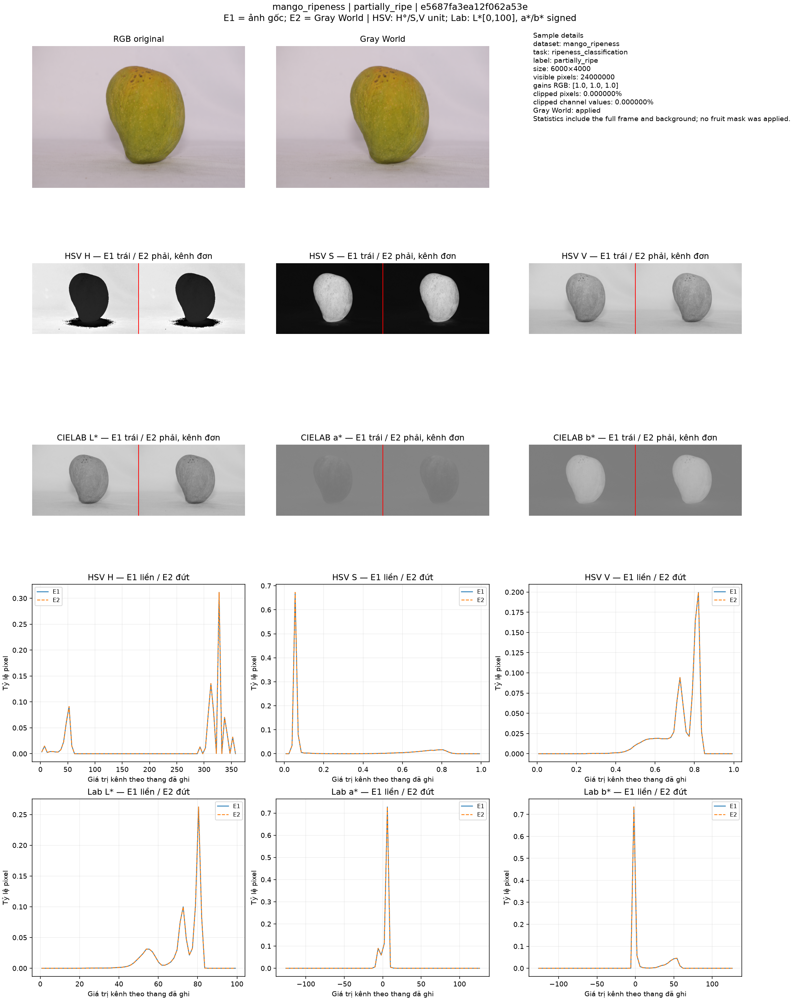

*Hình 1. RGB, Gray World, các kênh HSV/CIELAB và histogram của một mẫu Phase 1. Nguồn: `reports/phase1/previews/mango_ripeness__e5687fa3ea12f062a53e.png`; thống kê full-frame gồm nền.*

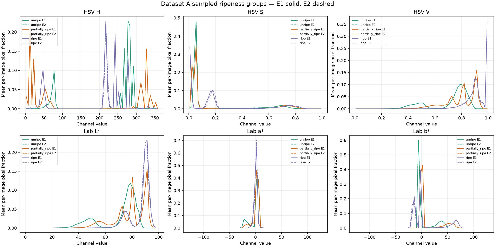

*Hình 2. Phân bố histogram trung bình theo nhóm độ chín trong mẫu Phase 1 (2 ảnh/nhóm). Nguồn: `reports/phase1/dataset_a_ripeness_histograms.png`; không đại diện toàn bộ Dataset A.*

Các đường E1/E2 ở một số lớp gần trùng vì Gray World bị bỏ qua khi gain gần 1 hoặc không được áp dụng. Trên nhóm ripe gồm hai ảnh, histogram và means dịch nhẹ; trên nhóm Dataset C healthy (n=2), ΔH trung bình là −40,23° và Δb* −32,46°. Đây chỉ là chênh lệch trên mẫu nhỏ, có thể phản ánh nền/ánh sáng. Ảnh clipping cực đại cho thấy phép nhân kênh có thể bão hòa highlight và xóa phân biệt cường độ. Tác động downstream chưa được cô lập bằng ablation nhân quả: lựa chọn Gray World cho ripeness đi cùng thay đổi feature group, classifier và kết quả CV/validation. Vì vậy không kết luận Gray World tự nó cải thiện phân loại.

### 4.2 Fruit segmentation có mask toàn quả được duyệt

34 ảnh trong bộ 35 candidate có mask semantic do người dùng duyệt; một ảnh vẫn pending và không được tính. Trên 5 ảnh validation, cấu hình Original + Lab b* + Otsu + binary được chọn theo paired mean IoU (0,9628) rồi Dice. Trên toàn bộ 34 approved, cùng cấu hình đạt mean IoU 0,8412, Dice 0,8993, precision 0,9949 và recall 0,8446. Gray World trên cùng tập đạt 0,7965/0,8684/0,9868/0,8027. Bốn metric ở bảng đều là trung bình theo ảnh.

| Biến thể | N approved | N paired có prediction | IoU | Dice | Precision | Recall | Prediction failure | Trạng thái |
|---|---:|---:|---:|---:|---:|---:|---:|---|
| Original + Lab b* + Otsu, binary | 34 | 34 | 0,8412 | 0,8993 | 0,9949 | 0,8446 | 0 | User-approved; exploratory |
| Gray World + Lab b* + Otsu, binary | 34 | 34 | 0,7965 | 0,8684 | 0,9868 | 0,8027 | 0 | User-approved; exploratory |

*Bảng 3. Mean theo ảnh trên cùng 34 approved whole-fruit masks.*

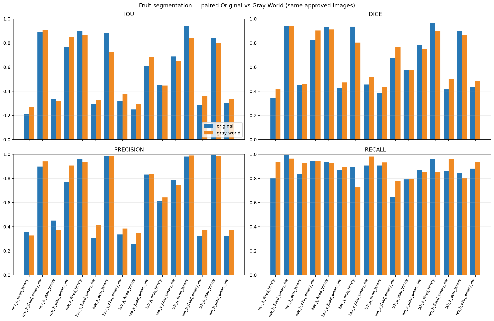

*Hình 3. Metric paired Original/Gray World trên 34 mask toàn quả người dùng duyệt. Nguồn: `reports/phase07_segmentation_comparison.png`.*

Hình 4 minh họa một trường hợp dự đoán dính vùng bóng/nền và một trường hợp không có plausible component. Điều này xác nhận lỗi quan sát được ở stage segmentation, nhưng không đủ để kết luận một nguyên nhân duy nhất cho tất cả ảnh. Recall thấp hơn precision cho thấy dự đoán thường nằm gọn trong mask tham chiếu nhưng bỏ sót một phần vùng quả. Chỉ 34 ảnh và cấu hình được lựa chọn trên một phần validation nhỏ; con số tổng thể là đánh giá exploratory, không phải ước lượng toàn quần thể.

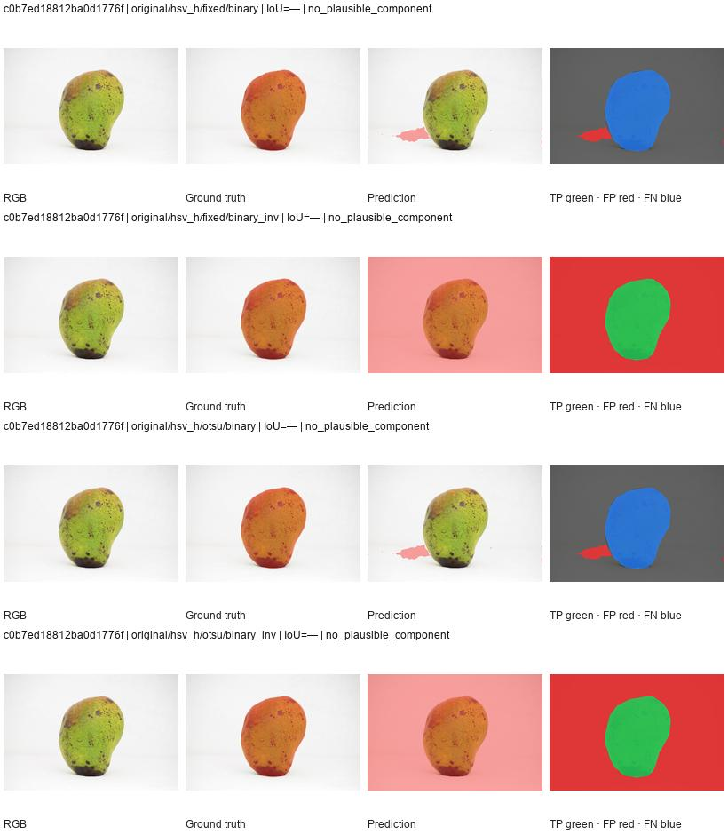

*Hình 4. Ví dụ artifact kiểm tra fruit segmentation, gồm lỗi nền/bóng và status `no_plausible_component`. Màu sai khác theo chú giải trong ảnh. Nguồn: `reports/phase07_review/fruit_segmentation/fruit_segmentation_review_01.jpg`.*

### 4.3 K-Means: pseudo-label Dataset C và bộ bruise 30 ảnh

#### 4.3.1 Kết quả exploratory trên mask Dataset C

Phase 3 có output hợp lệ cho 1.479/1.500 ảnh ở cả hai cấu hình Original Lab K=3 và Original HSV K=5 (coverage 98,6%). Khi tính trên 1.479 cặp có kết quả, Lab K=3 đạt mean IoU 0,3290, Dice 0,3944, pixel precision 0,4278, recall 0,4052 và detection hit 0,5767. HSV K=5 đạt 0,3058/0,4237/0,4446/0,5020 và detection hit 0,8796. Các giá trị trên đều là trung bình theo ảnh, không phải pixel-pooling.

| Cấu hình | Prediction / cohort (coverage) | Mean IoU | Mean Dice | Mean pixel Precision | Mean pixel Recall | Detection hit | Status/reference |
|---|---:|---:|---:|---:|---:|---:|---|
| Original + Lab K=3 | 1.479/1.500 (98,6%) | 0,3290 | 0,3944 | 0,4278 | 0,4052 | 0,5767 | Dataset C source pseudo-label; chưa user-approved |
| Original + HSV K=5 | 1.479/1.500 (98,6%) | 0,3058 | 0,4237 | 0,4446 | 0,5020 | 0,8796 | Dataset C source pseudo-label; chưa user-approved |

*Metric là trung bình per-image trên 1.479 kết quả của mỗi cấu hình; 21 trường hợp/config không có prediction do fruit mask unavailable vẫn nằm trong coverage denominator. Dataset/split: 1.500 cặp source mask Dataset C, scope toàn cohort segmentation, chưa chia train/validation/test cho lần so sánh này. Đây là đánh giá exploratory.*

Đây là so sánh trên source masks Dataset C đã resize/căn chỉnh, chưa được người dùng duyệt theo từng cặp; lineage augmented chưa giải quyết. Vì vậy các chỉ số chỉ mô tả độ trùng với pseudo-label trong cohort này.

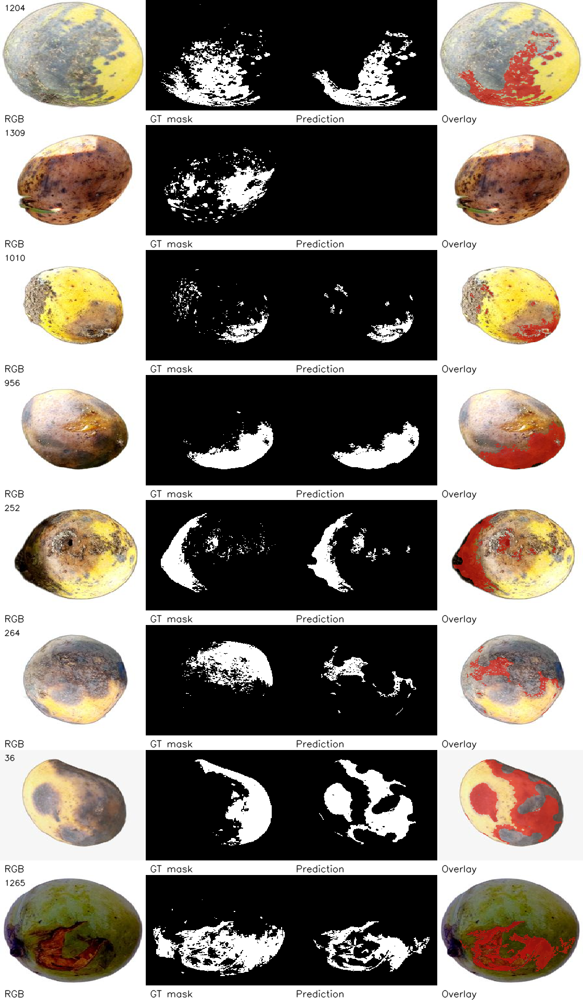

*Hình 5. Ví dụ cấu trúc RGB/source mask/prediction/overlay từ audit Phase 3. Đây không phải chuyên gia GT. Nguồn: `reports/phase03/previews/mask_semantics_audit.png`.*

#### 4.3.2 Đánh giá paired trên 30 mask tổn thương được người dùng duyệt

Tập bruise gồm đúng 30 ảnh Dataset B, cả 30 được ghi lesion presence `present`, `annotation_origin=codex_assisted`, và được người dùng xác nhận/approve; có 0 ảnh negative trong tập. Mỗi mask khớp kích thước/checksum và nhị phân; evaluator không điều chỉnh cấu hình. Coverage dự đoán là 30/30 cho mỗi model, không có inference failure. Vì tất cả ảnh là dương tính, detection rate chỉ là tỷ lệ ảnh dương có ít nhất một pixel TP; không đo specificity.

| Cấu hình (đã khóa Phase 3) | N paired / coverage | Mean IoU | Mean Dice | Pixel Precision* | Pixel Recall* | Detection hit | FP pixel | FN pixel | Trạng thái |
|---|---:|---:|---:|---:|---:|---:|---:|---:|---|
| Original + CIELAB K=3 | 30 / 30 (100%) | 0,3931 | 0,5141 | 0,7088 | 0,5343 | 24/30 (80,0%) | 6.486.213 | 13.757.631 | Codex-assisted; user-approved |
| Original + HSV K=5 | 30 / 30 (100%) | 0,3048 | 0,4346 | 0,4710 | 0,6033 | 29/30 (96,7%) | 20.021.501 | 11.721.076 | Codex-assisted; user-approved |

*Bảng 4. Đánh giá paired trên 30 positive assisted masks; denominator và kiểu pooling được ghi trong chú thích.*

\* IoU/Dice là mean theo ảnh; Precision/Recall và FP/FN là pixel-pooling. Mọi ảnh approved được giữ mẫu số; nếu inference unavailable thì prediction rỗng và coverage vẫn báo riêng. Trong run này không có ảnh unavailable.

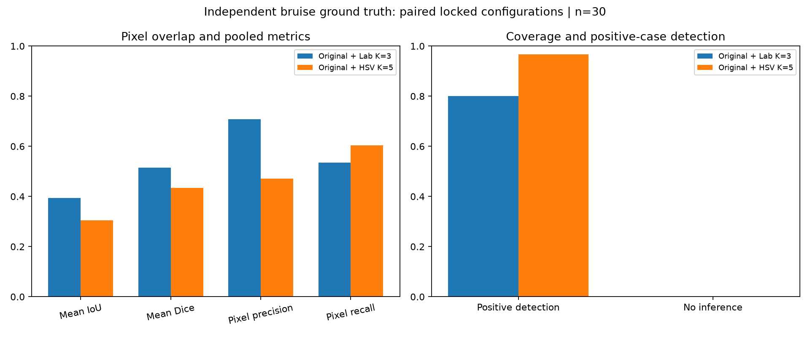

*Hình 6. Bảng biểu đồ của metric 30 ảnh assisted; nguồn `reports/bruise_gt_assisted_summary.csv` và `reports/bruise_gt_assisted_comparison.png`.*

Lab cao hơn HSV 0,0883 IoU, 0,0795 Dice và 0,2378 precision; HSV cao hơn recall 0,0690 và hit rate 0,1667. Kết hợp FP lớn hơn khoảng 13,54 triệu pixel của HSV với recall cao hơn cho thấy HSV thường phủ rộng hơn: phần diện tích dương tính phát hiện được tăng, nhưng có thể đưa nhiều pixel nền/vỏ bình thường vào mask. Lab bỏ lỡ 6/30 ảnh theo tiêu chí overlap, HSV bỏ lỡ 1/30. Đây là khác biệt metric quan sát được, không chứng minh HSV học “tổn thương” tốt hơn.

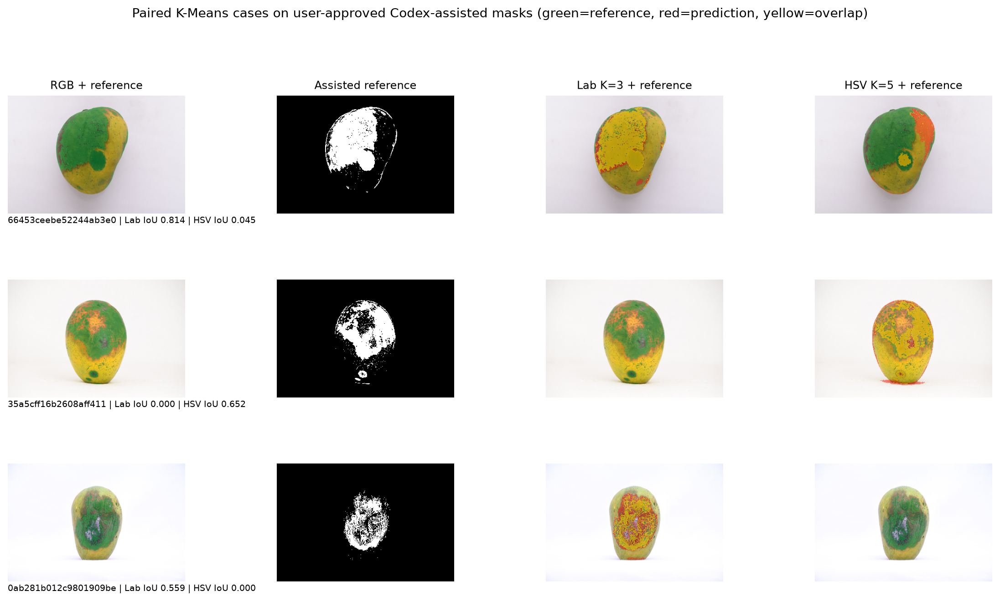

*Hình 7. Ba ví dụ được chọn theo chênh lệch metric per-image từ cùng CSV: trường hợp Lab có IoU cao hơn, HSV-only overlap và trường hợp Lab hit/HSV no-hit. Nguồn ảnh/mask/prediction: `reports/bruise_gt_assisted_metrics.csv` cùng các path được ghi trong đó. Các case minh họa, không phải mẫu ước lượng.*

Quan sát overlay cho thấy có trường hợp K-Means trùng đúng vị trí đốm nhưng mask chỉ phủ một phần ranh giới; có trường hợp chỉ một cấu hình tạo được overlap. Ở một số ảnh không-hit, RGB cho thấy các đốm nhỏ/tương phản thấp nhưng prediction không giao với reference; thiếu kích thước hoặc độ tương phản là giả thuyết hợp lý, chưa được cô lập. Một prediction HSV tạo dải pixel dưới đáy quả sát vùng tiếp xúc/bóng; đây là false-positive quan sát được, còn việc quy nguyên nhân cho bóng là giả thuyết. Các vùng prediction lan ra phần vỏ có màu tương tự lesion là false positive pixel theo mask, nhưng ảnh đơn lẻ không xác lập chúng là màu vỏ “bình thường” một cách chắc chắn. Fruit-mask status đều là `accepted_heuristic` ở 60 lượt suy luận; do đó không có inference failure được quy cho fruit mask trong tập này. Trạng thái accepted là kết quả heuristic, không phải chứng minh silhouette hoàn hảo. Trên Dataset C, trái lại, 21/1.500 ảnh/config không có prediction do fruit mask unavailable; chúng tạo coverage 98,6% thay vì bị bỏ khỏi denominator. Mask reference được tạo từ các cue Lab/HSV tối/nâu/local contrast, vì vậy sự tương đồng màu giữa mask tham chiếu và K-Means có thể tạo thiên lệch thuận lợi. Đây không phải đánh giá hoàn toàn độc lập về phương pháp màu.

### 4.4 Phân loại machine learning

#### 4.4.1 So sánh feature groups và model

Phase 5.1 có 30 tổ hợp (10 feature groups × 3 classifiers). Hình 8 tổng hợp Macro-F1 CV trung bình và validation Macro-F1 trực tiếp từ `phase051_search_results.csv`; các giá trị validation dùng để lựa chọn, không phải test. Mỗi ripeness row dùng Dataset A (train 524 / validation 112), mỗi defect row dùng Dataset C (train 2.523 / validation 541); CV là 5-fold group-aware trên train. Tất cả kết quả thuộc split Phase 5.1 provisional (`official_accuracy_eligible=false`). Bảng 5 cho biết tổ hợp tốt nhất theo validation trong từng group; classifier khác nhau trong cùng group vẫn thể hiện trên biểu đồ.

| Task / feature group | Model tốt nhất trên validation | Group-CV Macro-F1 mean ± SD | Val Macro-F1 | Missing fraction trong feature group |
|---|---|---:|---:|---:|
| R1 Original Color | SVM-RBF | 0,9581 ± 0,0141 | 0,9644 | 0,0% |
| R2 Gray World Color | KNN | 0,9503 ± 0,0205 | 0,9731 | 0,0% |
| D1 Original Color | SVM-RBF | 0,9808 ± 0,0049 | 0,9850 | 0,1% |
| D2 Original + Lab K3 | SVM-RBF | 0,9768 ± 0,0099 | 0,9794 | 6,4% |
| D3 Original + HSV K5 | SVM-RBF | 0,9716 ± 0,0060 | 0,9757 | 1,8% |
| D4 Original + Lab K3 + HSV K5 | SVM-RBF | 0,9716 ± 0,0086 | 0,9850 | 6,8% |
| G1 Gray World Color | SVM-RBF | 0,9140 ± 0,0196 | 0,9257 | 13,8% |
| G2 Gray World + Lab K3 | Random Forest | 0,9047 ± 0,0193 | 0,9203 | 20,7% |
| G3 Gray World + HSV K5 | Random Forest | 0,9008 ± 0,0251 | 0,9220 | 15,8% |
| G4 Gray World + Lab/HSV K-Means | Random Forest | 0,9043 ± 0,0216 | 0,9296 | 21,2% |

*Bảng 5. Tổ hợp validation tốt nhất trong mỗi feature group; biểu đồ Hình 8 có đủ 30 cấu hình để so classifier.*

Độ thiếu feature của nhóm Gray World/cluster cao hơn phần lớn nhóm Original vì một số mask hoặc K-Means block không khả dụng. Vì vậy chênh lệch không thể diễn giải chỉ là khác biệt màu; imputation và pattern missingness cũng có thể tham gia. Trên defect, D4/SVM ngang D1/SVM về validation Macro-F1 sau làm tròn (0,9850) nhưng CV trung bình thấp hơn; paired CV cho thấy D4 kém D1 ở cả 5 fold (Δ trung bình −0,0092 ± 0,0066). D4 sửa 4 lỗi validation và tạo 4 lỗi mới, tức không đổi lỗi ròng. Điều này không cho bằng chứng ổn định rằng K-Means bổ sung cải thiện phân loại.

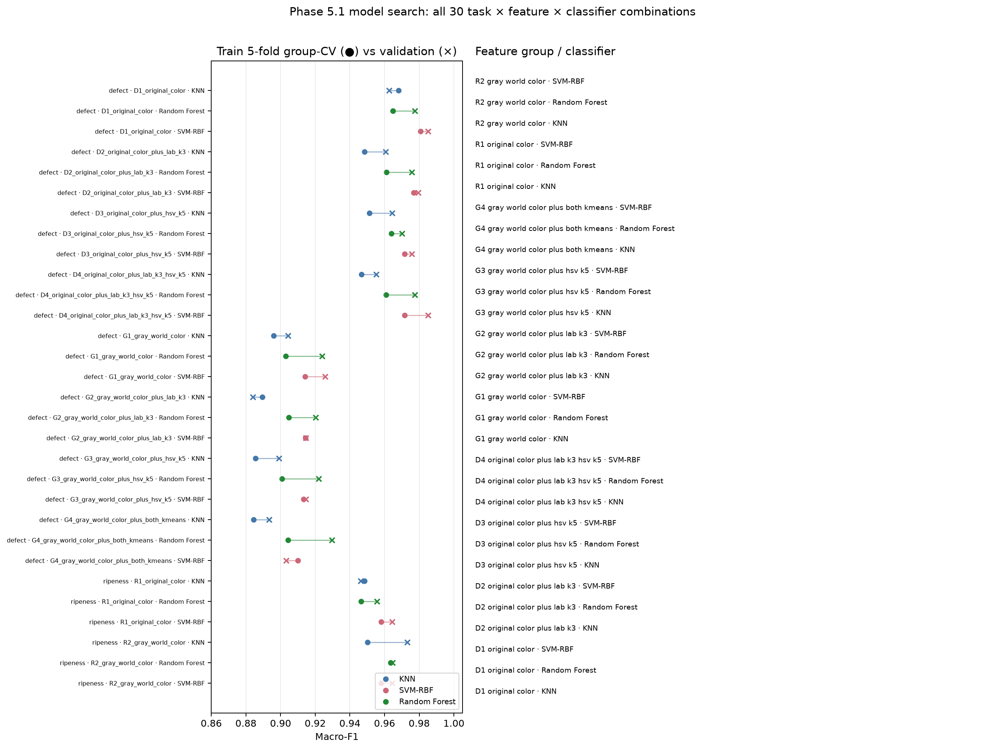

*Hình 8. Các metric lấy từ `reports/phase051/phase051_search_results.csv`; 5-fold group CV nằm trên train, validation dùng chọn cấu hình.*

#### 4.4.2 Model được giữ nguyên, test provisional và confusion matrix

| Task | Cấu hình Phase 5.1 đã khóa | Validation n / Accuracy / Macro-F1 | Test n / Accuracy / Macro-F1 | Eligibility |
|---|---|---|---|---|
| Độ chín A | Gray World + KNN | 112 / 0,9732 / 0,9731 | 112 / 0,9018 / 0,9021 | Provisional; `official_accuracy_eligible=false` |
| Defect C | Original Color + SVM-RBF | 541 / 0,9852 / 0,9850 | 540 / 0,9630 / 0,9626 | Provisional; `official_accuracy_eligible=false` |

*Bảng 6. Validation được dùng chọn model; test chỉ được báo cho winner đã khóa và vẫn provisional.*

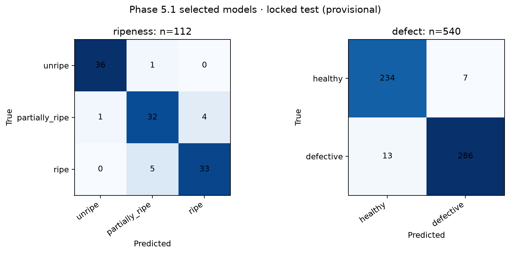

*Hình 9. Ripeness và defect confusion matrices lấy từ `reports/phase051/phase051_confusion_matrices.csv`; test chỉ dùng winner đã khóa, không dùng chọn model.*

Ripeness confusion matrix có 11 lỗi: partially-ripe bị nhầm sang ripe 4 lần, ripe sang partially-ripe 5 lần, và hai chiều unripe/partially-ripe một lần mỗi chiều. Các sai lệch tập trung ở giai đoạn liền kề, phù hợp với việc ranh giới nhãn chín có thể không sắc nét; đây là diễn giải, không phải nguyên nhân đã xác minh từng quả. Defect có 20 lỗi: 7 false positive trên healthy và 13 false negative trên defective. Chúng phản ánh nhãn cấp quả Dataset C, không phải khả năng định vị pixel. Các misclassified image IDs và stage được lưu trong CSV. Ảnh sai minh họa được đưa vào hình phụ/contact sheet; chúng không được dùng để điều chỉnh model.

Phase 5 trước đó có winner validation khác (ripeness Gray World + SVM-RBF; defect D4 + SVM-RBF), split 520/114/114 và 2.522/541/541. Phase 5.1 dùng split riêng 524/112/112 và 2.523/541/540 cùng audit lineage sâu hơn. Vì khác split và cách group, không lấy test Phase 5 cao hơn/thấp hơn làm so sánh paired; Phase 5.1 là cấu hình được giữ cho demo, nhưng các test scores vẫn provisional.

### 4.5 Robustness và external validation

#### 4.5.1 Paired robustness

Năm ảnh gốc từ Phase 5.1 test được biến đổi trong bộ nhớ: brightness ×1,05, contrast ×1,05, JPEG quality 90 và resize 80%. Cả 25/25 lượt inference (5 ảnh × 5 trạng thái gồm original) khả dụng. Prediction changed là 0/20 so sánh biến thể–gốc. Feature drift trung bình chuẩn hóa theo SD train lần lượt 0,1016; 0,1279; 0,0169; 0,0082. Đây là stress check nhỏ, không phải độ chính xác hay robustness trên mọi điều kiện.

| Biến đổi | Ảnh có inference | Prediction đổi / so sánh | Mean feature drift / train SD | Trạng thái |
|---|---:|---:|---:|---|
| Brightness ×1,05 | 5/5 | 0/5 | 0,1016 | Paired engineering check; n=5 test images |
| Contrast ×1,05 | 5/5 | 0/5 | 0,1279 | Paired engineering check; n=5 test images |
| JPEG quality 90 | 5/5 | 0/5 | 0,0169 | Paired engineering check; n=5 test images |
| Resize 80% | 5/5 | 0/5 | 0,0082 | Paired engineering check; n=5 test images |

*Bảng 7. Robustness paired trên 5 ảnh test; đây là kiểm tra kỹ thuật nhỏ.*

#### 4.5.2 Harumanis

Trong 141 candidate, 139 có dự đoán (coverage 98,6%). Unripe: 27/28 có dự đoán và tất cả dự đoán unripe; semi_ripe: 7/7 đều dự đoán unripe; ripe: 90/91 có dự đoán, phân bố 45 partially_ripe, 4 ripe, 41 unripe; rotten: 15/15, gồm 3 partially_ripe, 10 ripe, 2 unripe. Không tính Accuracy/Macro-F1 vì semi-ripe chưa được xác minh tương đương partially-ripe và rotten không có class đích tương ứng. Đây chỉ là coverage và phân bố output.

#### 4.5.3 MangoFruitBD v2

Trên MangoFruitBD, artifact Phase 5.1 Original Color + SVM-RBF được gọi nguyên trạng trên crop YOLO, không retrain. Trong 1.914 crop candidate, 1.811 đủ điều kiện metric nhị phân sau loại 103 crop nhãn subtype xung đột. 228/1.811 có inference khả dụng, coverage 12,6%; 1.583 trường hợp không suy luận được, phần lớn do fruit mask unavailable (1.572), thêm 4 ảnh quá giới hạn pixel và 7 quá giới hạn dung lượng. Trên 228 crop có prediction, confusion matrix là [[11,66],[10,141]] với lớp healthy/defective; Accuracy 0,6667, Macro-F1 0,5061. Healthy recall 0,143 (11/77), defective recall 0,934 (141/151). Tính trên source-group/frame-equal weights, Accuracy 0,7080 và Macro-F1 0,5192.

| Nguồn ngoài | Candidate | Đủ điều kiện | Có prediction | Coverage chính | Accuracy / Macro-F1 | Tình trạng đánh giá |
|---|---:|---:|---:|---:|---|---|
| Harumanis v2 | 141 | Không tính metric | 139 | 98,6% candidate | Không tính | Mô tả output; mapping lớp chưa xác minh |
| MangoFruitBD v2 | 1.914 | 1.811 | 228 | 12,6% trên eligible | 0,6667 / 0,5061 trên covered | External proxy; không tương đương internal test |

*Bảng 8. External evaluation; metric không tương đương với test nội bộ.*

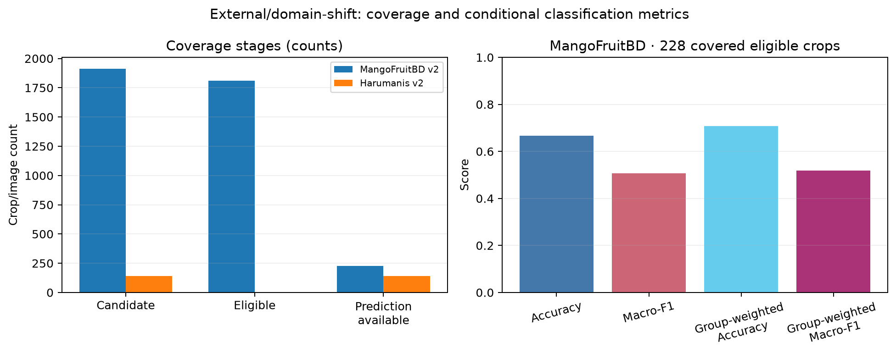

*Hình 10. Candidate, đủ điều kiện, có prediction và unavailable theo nguồn; metric chỉ hiển thị trên 228 crop đủ điều kiện có prediction. Nguồn: `reports/dataset_v2_external/metrics.json` và `predictions_by_sample.csv`.*

Đây không phải benchmark ngang hàng với internal test. Mapping Healthy→healthy và ba nhãn bệnh→defective là proxy cấp quả, không trùng hoàn toàn nhãn healthy/defective C; cũng không đánh giá mask bruise. Coverage thấp làm metric có điều kiện dễ thiên lệch về crop mà heuristic fruit mask xử lý được. Causation không thể tách giữa nền, kích thước crop, ánh sáng, class/source composition và domain shift. Harumanis cũng không cho phép accuracy. Vì vậy không tuyên bố Dataset v2 cải thiện hoặc làm giảm hiệu năng nội bộ.

### 4.6 Demo hệ thống

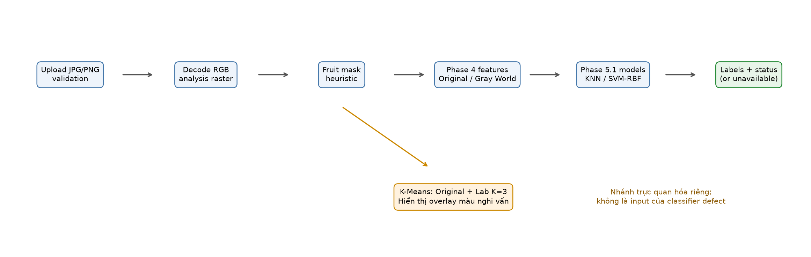

*Hình 11. Sơ đồ kiến trúc được tái dựng từ `app.py` và `src/demo/phase6.py`; đây là sơ đồ kỹ thuật, không phải ảnh chụp giao diện.*

Ứng dụng trình bày ảnh gốc, fruit mask heuristic, K-Means overlay, nhãn độ chín và nhãn healthy/defective. Smoke test trên ba ảnh Dataset A cho kết quả nhãn tương ứng; ảnh C `1000.jpg` cho defect prediction trong khi K-Means suspicious area là 0%; một ảnh PNG nền trắng tạo empty mask và trả unavailable. Những trường hợp đó xác minh luồng và khả năng báo lỗi, không phải đánh giá độ chính xác. Test Phase 6 trước đó ghi 7 test riêng và 82 test suite ở thời điểm chạy; đây là kiểm thử phần mềm lịch sử, không thay thế kiểm định nghiên cứu.

### 4.7 Biểu đồ chẩn đoán và contact sheet bổ sung

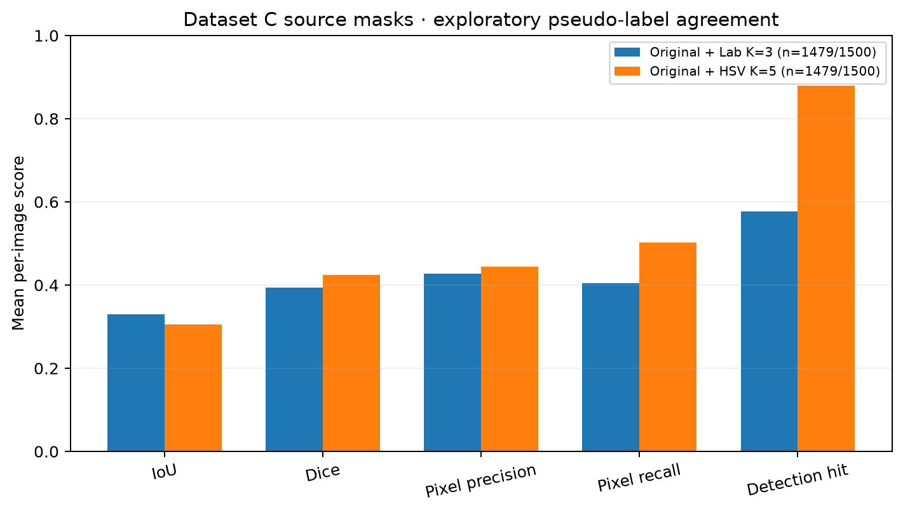

*Hình 12. Metric trung bình theo ảnh tính lại từ `reports/phase03_results.csv`; 1.479/1.500 có output/config. Đây là độ đồng thuận với pseudo-label, không phải ground truth người dùng duyệt.*

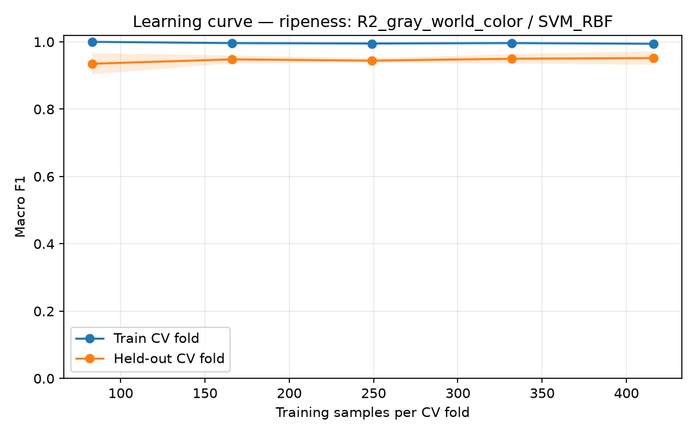

*Hình 13. Learning curve của Phase 5 (split và cấu hình lịch sử), lấy từ `reports/phase05_learning_curve_ripeness.png`; không phải Phase 5.1 và không dùng để báo test cuối.*

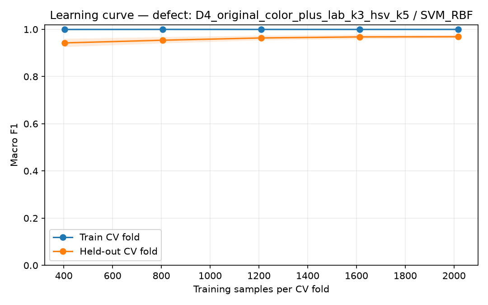

*Hình 14. Learning curve Phase 5 lịch sử từ `reports/phase05_learning_curve_defect.png`; khác split Phase 5.1.*

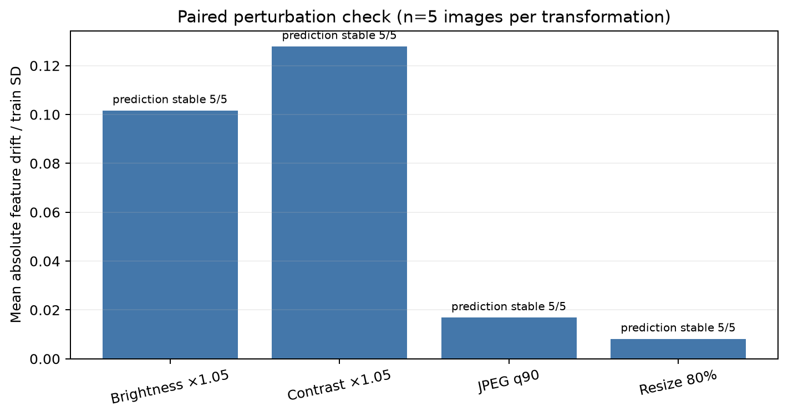

*Hình 15. Trung bình feature drift chuẩn hóa theo SD train, n=5 ảnh/biến đổi; nhãn stability lấy từ `reports/phase07_robustness.csv`.*

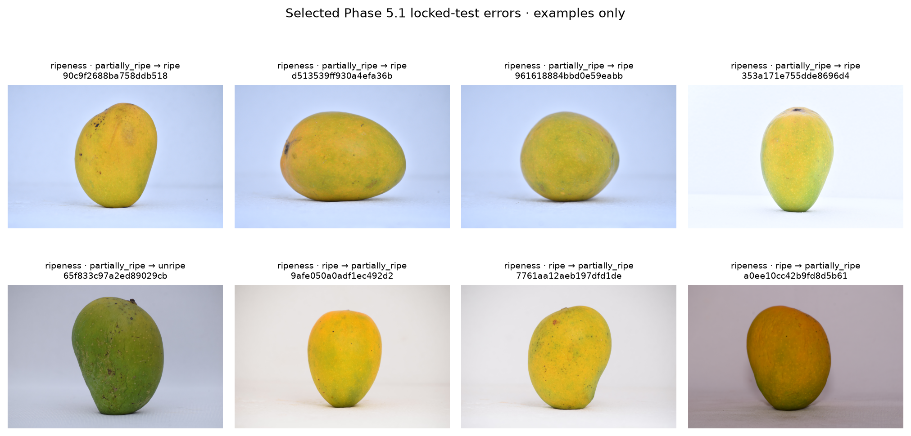

*Hình 16. Ảnh gốc và nhãn thật → dự đoán sai của winner trên test_locked. Contact sheet sinh từ `phase051_misclassifications.csv` và split manifest; ảnh chỉ minh họa, không giải thích nguyên nhân.*

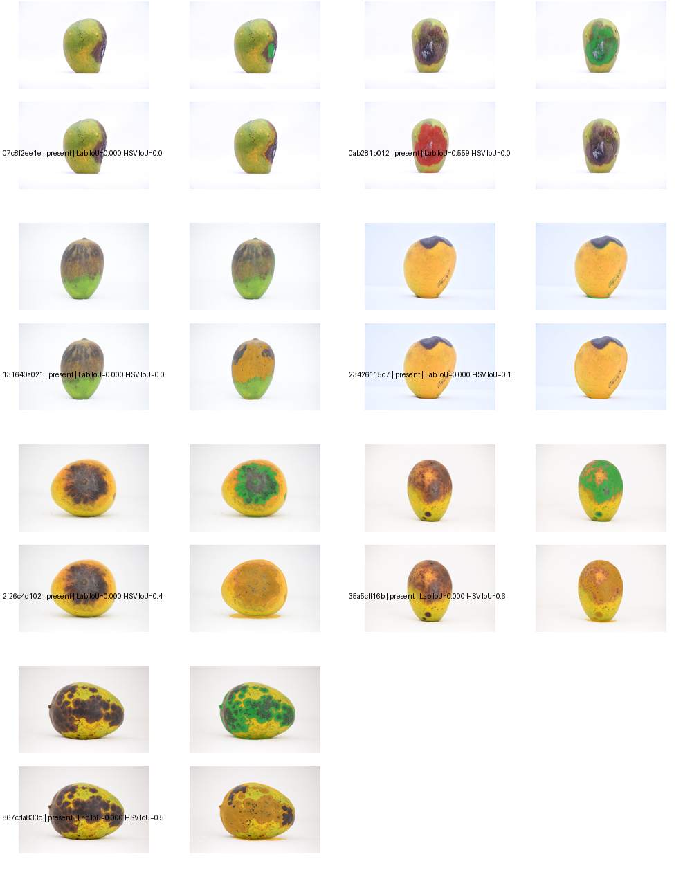

*Hình 17. Contact sheet failure cases của Phase 7, giữ nguyên nguồn; đây là ví dụ minh họa mask reference và prediction, không phải mẫu ngẫu nhiên.*

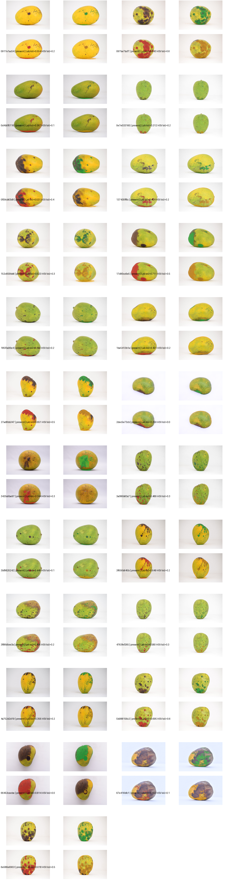

*Hình 18. Success-case sheet gốc của Phase 7; các trường hợp được chọn để kiểm tra ảnh/mask/prediction, không phải mẫu ngẫu nhiên.*

## Chương 5 — Thảo luận

### 5.1 Ý nghĩa của không gian màu và Gray World

HSV tách hue/saturation/value theo trực giác, thuận tiện xây các histogram/tỉ lệ màu. Tuy vậy H không ổn định khi saturation thấp, tuần hoàn tại biên 0/360°, còn V chứa cả phản xạ và chiếu sáng. CIELAB tách lightness khỏi hai trục đối lập và thuận tiện tính khoảng cách màu gần cảm nhận hơn trong điều kiện chuẩn hóa, nhưng vẫn phụ thuộc điểm trắng, camera, tone mapping và ánh sáng. Không gian màu không tự cung cấp ngữ nghĩa “tổn thương”.

Gray World có thể giảm cast màu khi trung bình scene thực sự gần trung tính. Trong bộ ảnh có nền trắng/chiếu sáng studio hoặc cảnh có tỷ lệ màu bất thường, giả định này có thể làm thay đổi giá trị màu của vỏ và clipping. Thí nghiệm Phase 1 đo biến đổi, không có ground truth illuminant. Classification validation chọn Gray World + KNN cho ripeness, song đây là một tổ hợp xử lý–feature–model; không suy ra Gray World là nguyên nhân tăng hiệu năng. Trên các nhóm defect, Gray World branches còn có missingness cao hơn, làm diễn giải khó hơn.

### 5.2 Diễn giải phân đoạn và K-Means

Fruit segmentation đạt precision cao và recall thấp hơn trên 34 ảnh: heuristic thường chọn một phần nhỏ gọn bên trong quả, đồng thời có thể bỏ vùng biên/đáy hoặc lỗi ở ảnh nền khó. 34 ảnh đủ để chỉ ra chất lượng không đồng nhất, nhưng không để ước lượng tổng thể toàn nguồn. Cấu hình được chọn trên năm validation images, nên mean trên 34 bao gồm validation data và không phải test độc lập.

Trên bruise set, Lab K=3 có IoU/Precision cao hơn; HSV K=5 có Recall/detection hit cao hơn đồng thời nhiều false-positive pixel. Mẫu hình này phù hợp với trade-off ngưỡng/chọn cụm hẹp so với rộng, nhưng không chứng minh cơ chế cụ thể. Vì mask tham chiếu Codex-assisted sử dụng cues màu Lab/HSV/local-darkness, bias theo phương pháp tham chiếu có thể nâng tương đồng của một số cấu hình màu. Con số “detection hit” chỉ đòi một pixel trùng, không nên gọi là tỷ lệ diện tích phát hiện chính xác. Không có no-lesion images nên không thể đo false alarm rate ở cấp ảnh hoặc specificity.

Pseudo-label Dataset C và assisted masks trả lời hai câu hỏi khác nhau. Pseudo-label C có quy mô 1.479 cặp/config nhưng chưa được người dùng duyệt và có augmentation lineage chưa rõ; metric phản ánh thỏa thuận với mask nguồn đã resize. Assisted bruise set chỉ có 30 ảnh, nhưng từng mask có xác nhận presence và approval của người dùng; nó giảm phụ thuộc vào K-Means làm reference, song biên mask vẫn Codex-assisted và chủ đích chọn từ Dataset B. Do đó không được gọi bộ này là independent manual pixel annotation.

### 5.3 Classification, K-Means features và nguy cơ leakage

Mặc dù D4 validation có Macro-F1 ngang D1 theo làm tròn, paired CV cho thấy D4 thấp hơn ở cả năm fold, đồng thời số lỗi validation sửa được bằng số lỗi mới. K-Means features có giá trị mô tả nhưng không tăng ổn định khả năng phân biệt lớp trong thí nghiệm này. Một giả thuyết là feature K-Means có missingness và phân bố khác theo cohort; một giả thuyết khác là pixel-region clustering không bổ sung nhiều thông tin so với histogram màu đã có. Các giả thuyết này chưa được kiểm định nhân quả.

Group-aware split xử lý duplicate/lineage đã biết, nhưng residual near-duplicate candidates và augmentation ancestry còn lại. Mô hình có thể tận dụng đặc trưng camera, nền hoặc điều kiện chụp liên quan nhãn. Đặc biệt defect C có nhiều ảnh augmented và cấu trúc nguồn chưa đủ; vì vậy số test cao không đồng nghĩa khả năng tổng quát hóa tương tự ngoài tập. Test Phase 5.1 vẫn provisional, dù không dùng để chọn cấu hình.

### 5.4 Chuyển miền và mức độ kết luận

MangoFruitBD cho thấy failure tập trung trước classifier: chỉ 228/1.811 crop đủ điều kiện đi qua inference. Accuracy có điều kiện 66,7% không mô tả 1.811 crop nếu 1.583 ảnh không có output; healthy recall thấp gợi ý lệch dự đoán mạnh về defective trong subset covered. Nhãn bệnh chi tiết, crop từ bounding box, độ phân giải/nền và khả năng tách fruit đều khác. Đây là quan sát, chưa đủ tách nguyên nhân. Harumanis có coverage cao nhưng class mapping không hợp lệ, minh họa rằng coverage tốt không đảm bảo metric accuracy có ý nghĩa.

Mức kết luận phù hợp là: pipeline đã được triển khai và kiểm tra trên các cohort nghiên cứu cụ thể; hai classifier phân loại có kết quả tốt trên test provisional nội bộ; fruit segmentation đạt metric khá trên một bộ người dùng duyệt nhỏ; K-Means có overlap ở mức hạn chế trên mask tổn thương, với trade-off rõ; external evaluation bị giới hạn bởi coverage và mapping. Không thể kết luận chất lượng trên toàn Dataset C, mọi giống xoài, mọi điều kiện ảnh, các bệnh cụ thể hoặc vận hành thương mại.

## Chương 6 — Kết luận và hướng phát triển

Nghiên cứu đã hoàn tất quy trình từ inventory/preprocessing, biểu diễn HSV/CIELAB và Gray World đến heuristic segmentation, K-Means, feature extraction, phân loại và Streamlit demo. Model Phase 5.1 được giữ nguyên. Trên test provisional, Gray World + KNN đạt Accuracy/Macro-F1 0,9018/0,9021 cho độ chín; Original Color + SVM-RBF đạt 0,9630/0,9626 cho defect. Các số này cần được xem cùng `official_accuracy_eligible=false` và residual leakage/lineage risks.

Mask toàn quả được người dùng duyệt hỗ trợ đối chiếu định lượng, nhưng chỉ gồm 34 ảnh. Bộ bruise gồm 30 assisted masks do người dùng duyệt cho phép đánh giá paired K-Means: Lab K=3 ưu tiên precision/overlap, HSV K=5 ưu tiên recall/detection hit và phát sinh nhiều false positives. Ground truth bruise là Codex-assisted và có nguy cơ thiên lệch màu; nó không phải chẩn đoán nông nghiệp hay independent manual pixel annotation. External test cho thấy coverage là nút thắt lớn hơn nhiều so với classification metric có điều kiện.

Hướng nghiên cứu tiếp theo là thu thập thêm mask tổn thương được chú giải độc lập với đặc trưng màu và có hướng dẫn ranh giới rõ; bổ sung ảnh không tổn thương để đánh giá false alarm; xác minh augmentation/source lineage và near duplicates; cải thiện fruit segmentation trên nhiều kích thước, nền và điều kiện chụp; xây external cohort có định nghĩa nhãn thống nhất; và báo cáo coverage/uncertainty theo từng điều kiện. Những bước này cần được hoàn thành trước khi xem xét một đánh giá triển khai rộng. Báo cáo hiện tại không tuyên bố hệ thống đủ điều kiện ứng dụng thương mại.

## Tuyên bố phạm vi

Dataset A/C tiếp tục là dữ liệu nghiên cứu chính; Dataset v2 chỉ là external/domain-shift analysis. Dataset C source masks được gọi là pseudo-label; 30 bruise masks là Codex-assisted, người dùng duyệt; 34 fruit masks là whole-fruit masks được người dùng duyệt. Không điều chỉnh K, ngưỡng hoặc thuật toán theo bộ 30 ảnh; không huấn luyện lại; không thay đổi Phase 0–7 artifacts.

## Nguồn số liệu và tài liệu

Danh mục tài liệu tham khảo và kiểm chứng metadata: [`references.md`](references.md).
